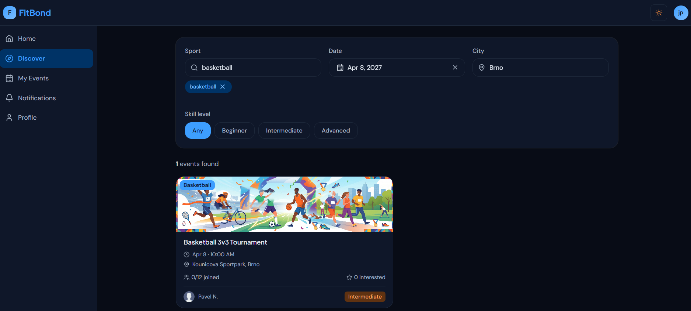
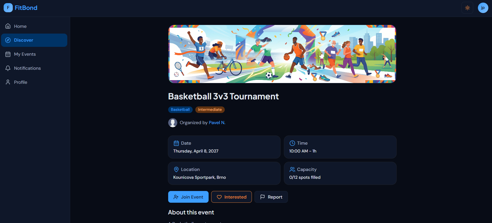
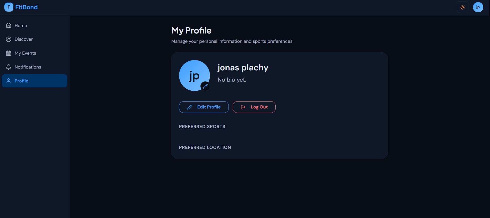
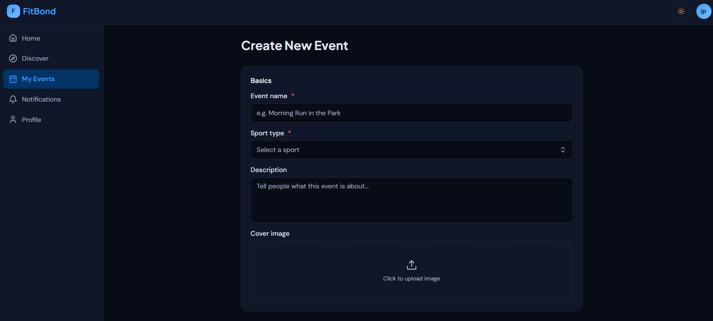
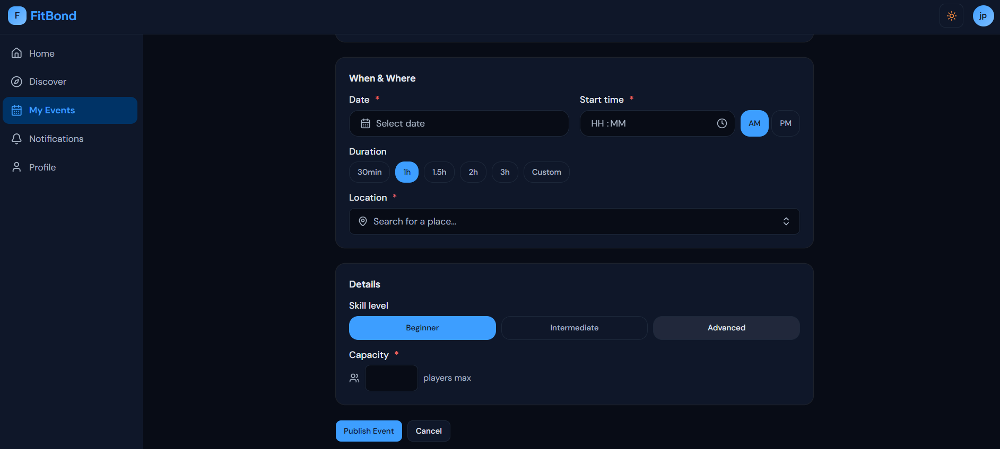
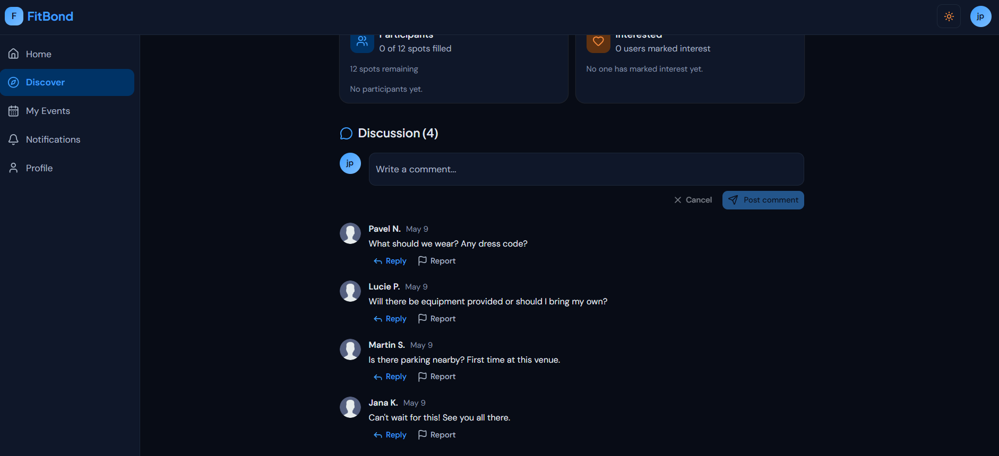
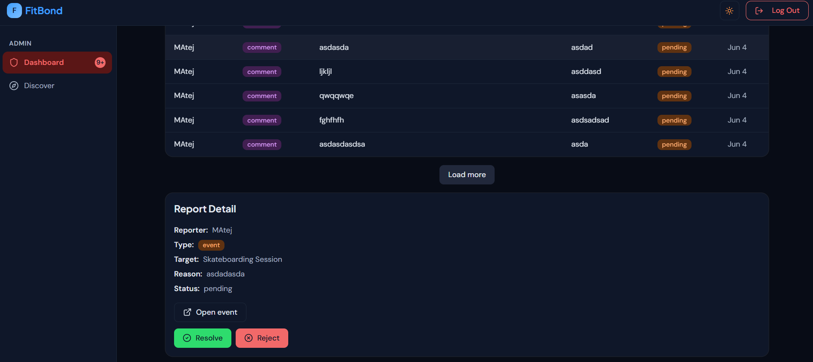
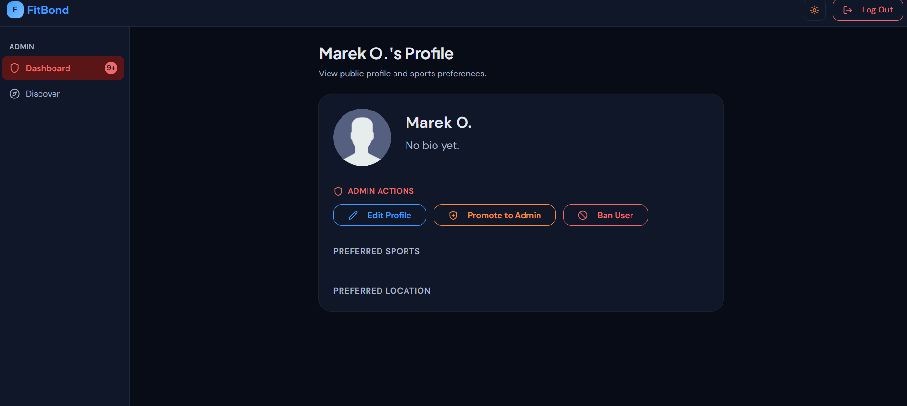

# FitBond

A social sports application where users can find workout partners, organize local sports events, and build an active community.
It was made as a team project for the 'PB138 - Basics of Web Development and Markup Languages' course at the Faculty of Informatics of Masaryk University.

## Team

* **Matej Gálfy** - Backend Development & Frontend Support
* **Samuel Burger** - Backend Development & Deployment
* **Šimon Jelínek** - Frontend Development
* **Maroš Mičák** - Frontend Development

## Tech Stack

The project was written in TypeScript using the Bun runtime. The backend uses the Elysia framework with a PostgreSQL database managed by Drizzle ORM. The frontend is a Single Page Application built with React 19, Vite, TanStack Router/Query, and styled using Tailwind CSS v4 and Shadcn/ui. Type safety is guaranteed end-to-end between the backend and frontend.

## Screenshots

<table>
  <tr>
    <td align="center"><b>Discover Page</b></td>
    <td align="center"><b>Event Detail</b></td>
    <td align="center"><b>Profile Page</b></td>
  </tr>
  <tr>
    <td align="center"></td>
    <td align="center"></td>
    <td align="center"></td>
  </tr>
</table>
<table>
  <tr>
    <td align="center"><b>Event Creation 1</b></td>
    <td align="center"><b>Event Creation 2</b></td>
    <td align="center"><b>Comment Section</b></td>
  </tr>
  <tr>
    <td align="center"></td>
    <td align="center"></td>
    <td align="center"></td>
  </tr>
</table>
<table>
  <tr>
    <td align="center"><b>Admin Dashboard</b></td>
    <td align="center"><b>Admin Profile</b></td>
  </tr>
  <tr>
    <td align="center"></td>
    <td align="center"></td>
  </tr>
</table>

## Requirements
* **Bun (v1.0 or later)**
* **Docker & Docker Compose:** For running the PostgreSQL database
* **Git:** For version control
* **Node.js (v20 LTS or later):** Required only for E2E tests (Playwright)

## How to Run

### Local Development
For  detailed instructions, API documentation, and deployment guides, please refer to the [Developer Guide](CONTRIBUTING.md).

### Website
The application was deployed and hosted on [fit-bond.app](https://fit-bond.app), but currently
it is unavailable.
